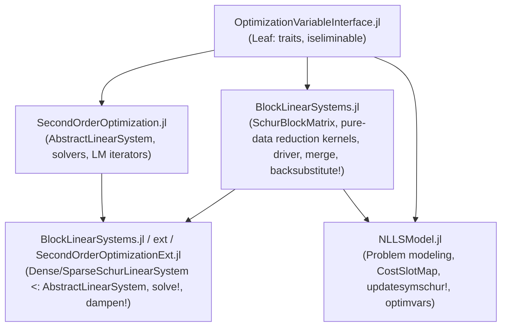

# Schur-Complement Linear Solver: Architectural Blueprint & Implementation Specification

This document provides a mathematically rigorous, structurally verified, and actionable specification for implementing high-performance **Dense and Sparse Schur-Complement Linear Solvers** for block-structured non-linear least squares (Bundle Adjustment, SLAM, and structured factor graphs).

---

## 1. Executive Summary & Mathematical Foundation

### A. The Bipartite Normal Equations
In geometric vision (Bundle Adjustment) and robotics (SLAM), variables naturally partition into two classes:
1. **Retained Variables ($c$, "Cameras / Poses / Intrinsics")**: Mutually coupled via shared observations ($N_c \approx 10^1 \text{--} 10^4$).
2. **Eliminable Variables ($p$, "Points / Landmarks")**: Mutually decoupled—no cost residual connects two unfixed points ($N_p \approx 10^3 \text{--} 10^6$).

The Gauss-Newton normal equations take the $2 \times 2$ block form:
$$\begin{bmatrix} B & E \\ E^T & C \end{bmatrix} \begin{bmatrix} \Delta x_c \\ \Delta x_p \end{bmatrix} = \begin{bmatrix} g_c \\ g_p \end{bmatrix}$$

where:
- $B \in \mathbb{R}^{n_c \times n_c}$ is the Hessian block over retained variables ($n_c = \sum_{i=1}^{N_c} d_{c, i}$).
- $C \in \mathbb{R}^{n_p \times n_p}$ is **block-diagonal**: $C = \operatorname{blkdiag}(C_1, C_2, \dots, C_{N_p})$ with small static blocks $C_l \in \mathbb{R}^{d_{p, l} \times d_{p, l}}$ (e.g. $3 \times 3$ for 3D landmarks, $1 \times 1$ for inverse depth).
- $E \in \mathbb{R}^{n_c \times n_p}$ is block-sparse, encoding the camera-to-point observation bipartite graph.
- $g_c \in \mathbb{R}^{n_c}$ and $g_p \in \mathbb{R}^{n_p}$ are the negative gradient vectors ($b = -\nabla f$).

### B. Levenberg-Marquardt Damping
With damping parameter $\lambda \ge 0$ and diagonal scaling vector $D = [D_c; D_p]$:
$$B(\lambda) = B + \lambda \operatorname{diag}(D_c)^2, \qquad C(\lambda) = C + \lambda \operatorname{diag}(D_p)^2$$

where $D_i = \sqrt{\max(H_{ii}, \epsilon_{\text{scale}})}$ with scale-invariant floor $\epsilon_{\text{scale}} = 10^{-12} \cdot \operatorname{median}(\operatorname{diag}(H))$.

> [!NOTE]
> Scaling vector $D$ is computed **once per outer iteration** via `update_marquardt_scaling!(ls)` immediately following Jacobian assembly from $\operatorname{diag}(B)$ and $\operatorname{diag}(C)$. Damping updates via `dampen!(ls, lambda)` during inner trial retries adjust $\lambda$ only, leaving $D$ strictly constant.

### C. Schur Reduction (Marginalization)
Inverting $C(\lambda)$ decomposes into $N_p$ independent static block inversions:
$$C(\lambda)^{-1} = \operatorname{blkdiag}\left(C_1(\lambda)^{-1}, C_2(\lambda)^{-1}, \dots, C_{N_p}(\lambda)^{-1}\right)$$

Multiplying the second block row by $E \, C(\lambda)^{-1}$ and subtracting it from the first yields the **Reduced Camera System** (Schur complement):
$$S(\lambda) \, \Delta x_c = g_S(\lambda)$$

where:
$$S(\lambda) = B(\lambda) - E \, C(\lambda)^{-1} E^T = B(\lambda) - \sum_{l=1}^{N_p} E_l \, C_l(\lambda)^{-1} E_l^T$$
$$g_S(\lambda) = g_c - E \, C(\lambda)^{-1} g_p = g_c - \sum_{l=1}^{N_p} E_l \, z_l, \qquad z_l = C_l(\lambda)^{-1} g_{p, l}$$

### D. Exploiting Matrix Symmetry (Upper Triangle Assembly)
Because observing camera indices are sorted in strictly ascending order ($c_1 < c_2 < \dots < c_k$) for each landmark, assembly strictly targets the upper triangle without branch swapping:
- **Off-diagonal camera pairs ($c_1 < c_2$)**:
  $$\Delta S_{c_1, c_2} = - W_{c_1 l} \, E_{c_2 l}^T \quad \left(d_{c1} \times d_{c2} \text{ block}\right), \quad \text{where } W_{cl} = E_{cl} \, C_l(\lambda)^{-1}$$
- **Diagonal blocks ($c_1 = c_2$)**:
  $$\Delta S_{c, c}(r, c) = - \sum_{k=1}^{D_p} W_{cl}(r, k) \, E_{cl}(c, k) \quad \text{for } 1 \le r \le c \le d_c$$
This halves floating point operations ($\sum \frac{1}{2} (\sum d_c)^2 D_p$) and matches upper-triangle storage for LAPACK (`potrf!`) and CHOLMOD (`uplo = 'U'`).

### E. Zero-Factorization Back-Substitution
By caching $C_l(\lambda)^{-1}$ and $z_l = C_l(\lambda)^{-1} g_{p, l}$ during the reduction phase, back-substitution requires **zero matrix factorizations**:
$$\Delta x_{p, l} = z_l - C_l(\lambda)^{-1} \sum_{c \sim l} E_{cl}^T \, \Delta x_c, \qquad \forall l \in \{1, \dots, N_p\}$$

### F. Complexity & Memory Realities
| Approach | Solve / Factorization Complexity | Peak Memory Footprint |
| :--- | :--- | :--- |
| **Full Dense Factorization** | $O((n_c + n_p)^3)$ | $O((n_c + n_p)^2)$ |
| **Full Sparse Cholesky (AMD)** | $O(\text{flops}(\mathcal{G}))$; eliminates points early, but suffers fill-in between cameras and full-graph tracking | Sparse graph over $N_c + N_p$ nodes |
| **Schur Reduction (Dense $S$)** | $O\left(\frac{1}{3} n_c^3 + \sum_l \frac{1}{2} (\sum_{c \sim l} d_c)^2 D_p + \sum_l D_p^3\right)$ | $(2 + 2K) n_c^2 \times 8 \text{ B} + \text{sizeof}(E) + \text{sizeof}(C)$ |
| **Schur Reduction (Sparse $S$)** | $O\left(\text{flops}(L) + \sum_l \frac{1}{2} (\sum_{c \sim l} d_c)^2 D_p + \sum_l D_p^3\right)$ | $(\text{nnz}(L) + (1 + K)\text{nnz}(S) + (1 + K)\text{nnz}(B) + \text{nnz}(E)) \times 8 \text{ B}$ |

> [!IMPORTANT]
> To prevent memory explosion on large thread counts, scratch memory is capped by an automatic **Memory Guardrail**:
> $$\text{RAM}_{\text{scratch}} \le 128\text{ MB} \implies K = \operatorname{clamp}\left(\left\lfloor \frac{128\text{ MB}}{\text{bytes\_per\_buffer}} \right\rfloor, 1, \text{Threads.nthreads()}\right)$$
> This formally decouples chunk count $K$ from thread count.

---

## 2. Package Boundaries & Responsibilities

The package architecture enforces strict decoupling. Core algorithms live in `BlockLinearSystems.jl` taking pure data arrays, allowing 100% unit testing without loading `SecondOrderOptimization.jl`:



| Package | Ownership & Concrete Responsibilities |
| :--- | :--- |
| [`OptimizationVariableInterface.jl`](file:///Users/olly/.julia/dev/OptimizationVariableInterface.jl) | Declares and exports `iseliminable(::Type{V})` trait (defaults to `static(false)`). |
| [`SecondOrderOptimization.jl`](file:///Users/olly/.julia/dev/SecondOrderOptimization.jl) | `AbstractLinearSystem` interface contracts (`solve!`, `dampen!`, `SolveStatus`). Has **zero dependencies** on `BlockLinearSystems.jl`. |
| [`BlockLinearSystems.jl`](file:///Users/olly/.julia/dev/BlockLinearSystems.jl) | **Owns all core matrix layouts and pure-data reduction drivers & kernels**:<br>• `SchurBlockStructure` and `SchurBlockMatrix{T, BType}`.<br>• `SchurReductionWorkspace{T}`.<br>• `inv_sym_block` (static analytic inverse).<br>• Pure-data kernels: `reduce_schur_dense_group!` and `reduce_schur_sparse_group!`.<br>• Pure-data drivers: `reduce_schur_dense!`, `reduce_schur_sparse!`, `merge_dense_S!`, `merge_sparse_S!`, and `backsubstitute!`.<br>• Symbolic camera co-visibility analysis, block-AMD ordering, and `b_to_s_map`.<br>• Fully unit-testable on plain arrays without `SecondOrderOptimization`. |
| [`BlockLinearSystems.jl` (Extension `SecondOrderOptimizationExt`)](file:///Users/olly/.julia/dev/BlockLinearSystems.jl) | **Integrates systems into `SecondOrderOptimization`**:<br>• Defines `DenseSchurLinearSystem{T} <: AbstractLinearSystem`.<br>• Defines `SparseSchurLinearSystem{T, Ti} <: AbstractLinearSystem`.<br>• Implements `solve!`, `dampen!`, `copy_structure`, and `quadratic_model_reduction`.<br>• Overloads `SecondOrderOptimization.makelinearsystem(x0, H::SchurBlockMatrix, linsolver)`. |
| [`NLLSModel.jl`](file:///Users/olly/.julia/dev/NLLSModel.jl) | **Problem modeling and residual accumulation**:<br>• Structural bipartite validation and two-pass variable ordering.<br>• CSR-layout `CostSlotMap` construction.<br>• Landmark-partitioned `updatesymschur!` assembling $J^T J$ into $B, E, C$.<br>• Returns `H::SchurBlockMatrix` from `optimvars`. |

---

## 3. Variable Partitioning & Two-Pass Ordering

### A. Minimal Specification API
1. **Trait Default**: Variable types declare structural eligibility:
   ```julia
   OptimizationVariableInterface.iseliminable(::Type{<:Point3D}) = static(true)
   OptimizationVariableInterface.iseliminable(::Type{<:InverseDepth}) = static(true)
   ```
2. **Explicit User Override**: Passed via `OptimizationOptions`:
   ```julia
   options = OptimizationOptions(
       linsolver = :schur, # or :dense_schur / :sparse_schur
       eliminable_mask = is_point_bitvector # or eliminable_indices = landmark_indices
   )
   ```

### B. Structural Bipartite Validation
During problem construction (and whenever fixed variables change), `NLLSModel.jl` performs a single $O(|residuals|)$ scan:
1. Validates that $\ge 1$ unfixed retained variable and $\ge 1$ unfixed eliminable variable exist.
2. **Block-Diagonality Check**: Inspects every active cost residual. If any residual connects two unfixed eliminable variables, throws an informative `ArgumentError`.
3. **Static Eliminable Dimension**: Validates that all eliminable variables have statically known sizes $D_p \in \{1, 2, 3\}$.

### C. Two-Pass Variable Ordering
To ensure strict RLE group contiguity alongside optimal cache locality:
- **Pass 1 (Role & Dimension)**: `sort_blocks_hierarchical(roles, dimensions)` orders retained variables first (sorted by dimension, e.g. 6-DoF poses, then 3-DoF intrinsics), followed by eliminable variables (sorted by dimension, e.g. 3-DoF points, then 1-DoF depths).
- **Pass 2 (Cache Locality Sort)**: Within each static eliminable dimension group, landmarks are ordered by primary observing camera index:
  $$c_{\min}(l) = \min_{c \sim l} c$$
  This ensures that threads access camera blocks in $S$ with maximal spatial locality without breaking dimension group contiguity.
- **Sorted Coupling**: Within each landmark $l$, observing camera block indices `cpblock` are stored in strictly ascending order ($c_1 < c_2 < \dots < c_k$).

---

## 4. Memory Architecture & Concrete Struct Definitions

### A. Shared Bipartite Block Storage (`SchurBlockMatrix` in `BlockLinearSystems.jl`)
```julia
struct SchurBlockStructure
    nc::Int                          # Total scalar dimension of retained variables
    ncblocks::Int                    # Number of retained blocks
    npblocks::Int                    # Number of eliminable blocks
    blocksizes::BlockRLE{UInt8, Int} # RLE block dimensions (cameras then points)
    c_dims::Vector{UInt8}            # Pre-extracted O(1) dimension per camera block
    p_dims::Vector{UInt8}            # Pre-extracted O(1) dimension per point block
    boffsets_c::Vector{Int}          # 1-based start scalar offset of each camera block
    boffsets_p::Vector{Int}          # 1-based start scalar offset of each point block
    
    # Eliminable diagonal block indexing (C)
    ppoffsets::Vector{Int}           # 1-based start of each C_l block in flat C_data (sum_l d_l^2)
    
    # Merged bipartite coupling indexing (E) - Landmark-Major CSR
    # Each unique (camera, landmark) pair has exactly ONE entry in E
    # cpblock[cpptr[l]:cpptr[l+1]-1] is strictly sorted ascending: c1 < c2 < ... < ck
    cpptr::Vector{Int}               # Landmark-major pointer: length npblocks + 1
    cpblock::Vector{Int}             # Retained camera block index for each coupling entry
    cpoffsets::Vector{Int}           # Start offset in E_data for each block
    
    # Dynamic workspace sizing: maximum sum_{c in obs(l)} d_c across all landmarks
    max_obs_dim::Int
    
    # Static dispatch groups
    p_groups::Vector{UnitRange{Int}} # Grouped by static landmark size
    p_sizes::Vector{Int}             # Static landmark dimensions (e.g. [3] or [3, 1])
    
    # Pre-computed workload chunks for parallel reduction
    chunks::Vector{Vector{UnitRange{Int}}} # chunks[group_idx][chunk_id]
end

struct SchurBlockMatrix{T, BType}
    B::BType                         # Matrix{T} (dense) or SparseBlockLinearSystem (sparse)
    C_data::Vector{T}                # Contiguous storage for block-diagonal C: sum_l d_l^2
    E_data::Vector{T}                # Contiguous storage for block-sparse E: sum_e (d_c * d_l)
    structure::SchurBlockStructure
end
```

### B. Pre-allocated Solver Workspace (`BlockLinearSystems.jl`)
```julia
struct SchurReductionWorkspace{T}
    # Per-chunk scratch for W_cl = E_cl * C_inv: length nchunks, each (max_Dp, max_obs_dim)
    W_scratch::Vector{Matrix{T}}
    
    # Caches for zero-factorization back-substitution
    C_inv_data::Vector{T}            # Cached C_l(lambda)^-1: sum_l d_l^2
    z_data::Vector{T}                # Cached z_l = C_l(lambda)^-1 * g_pl: sum_l d_l
    
    # Per-chunk gradient accumulators (length nc per chunk)
    thread_g_S::Vector{Vector{T}}
    
    # Per-chunk accumulators for parallel reduction
    thread_nzvals::Vector{Vector{T}} # nnz(S) floats per chunk (Sparse path)
    thread_dense_S::Vector{Matrix{T}}# nc x nc matrix per chunk (Dense path)
    
    # Failure communication: stores 0 if success, or minimum failing landmark index
    failed_landmark::Base.Threads.Atomic{Int}
end
```

### C. Concrete Linear System Types (`ext/SecondOrderOptimizationExt.jl`)
```julia
mutable struct DenseSchurLinearSystem{T} <: AbstractLinearSystem
    H::SchurBlockMatrix{T, Matrix{T}}
    b::Vector{T}                     # Full gradient [g_c; g_p]
    x::Vector{T}                     # Full solution step [Delta x_c; Delta x_p]
    b_c::SubArray{T, 1, Vector{T}, Tuple{UnitRange{Int}}, true}
    b_p::SubArray{T, 1, Vector{T}, Tuple{UnitRange{Int}}, true}
    x_c::SubArray{T, 1, Vector{T}, Tuple{UnitRange{Int}}, true}
    x_p::SubArray{T, 1, Vector{T}, Tuple{UnitRange{Int}}, true}
    g_S::Vector{T}                   # Reduced camera gradient: length nc
    S::Matrix{T}                     # Reduced camera Hessian: nc x nc
    lambda::T                        # LM damping parameter
    scaling::Vector{T}               # Full joint scaling [D_c; D_p] (never rebound)
    scaling_c::SubArray{T, 1, Vector{T}, Tuple{UnitRange{Int}}, true}
    scaling_p::SubArray{T, 1, Vector{T}, Tuple{UnitRange{Int}}, true}
    workspace::SchurReductionWorkspace{T}
end

mutable struct SparseSchurLinearSystem{T, Ti} <: AbstractLinearSystem
    H::SchurBlockMatrix{T, SparseBlockLinearSystem{T}}
    b::Vector{T}
    x::Vector{T}
    b_c::SubArray{T, 1, Vector{T}, Tuple{UnitRange{Int}}, true}
    b_p::SubArray{T, 1, Vector{T}, Tuple{UnitRange{Int}}, true}
    x_c::SubArray{T, 1, Vector{T}, Tuple{UnitRange{Int}}, true}
    x_p::SubArray{T, 1, Vector{T}, Tuple{UnitRange{Int}}, true}
    g_S::Vector{T}
    S::SparseMatrixCSC{T, Ti}        # Upper-triangular co-visibility graph (full diagonal blocks)
    S_factor::SparseArrays.CHOLMOD.Factor{T} # Cached symbolic factor
    b_to_s_map::Vector{Int}          # Scatter indices from H.B to S.nzval
    diag_inds::Vector{Int}           # Diagonal indices in S.nzval
    block_rowval::Vector{Ti}         # Block-level CSC row indices for fast search
    block_colptr::Vector{Ti}         # Block-level CSC column pointers
    block_row_offsets::Vector{Int}   # Row offset in scalar column for each block in pattern
    col_heights::Vector{Int}         # Total scalar height of each block column in S
    lambda::T
    scaling::Vector{T}               # Full joint scaling [D_c; D_p] (never rebound)
    scaling_c::SubArray{T, 1, Vector{T}, Tuple{UnitRange{Int}}, true}
    scaling_p::SubArray{T, 1, Vector{T}, Tuple{UnitRange{Int}}, true}
    workspace::SchurReductionWorkspace{T}
end
```

---

## 5. Cost-to-Slot Mapping & Residual Assembly

### A. CSR CostSlotMap
Both $B$ and $E$ block writes use flat CSR indexing:
```julia
struct CostSlotMap
    # B block writes per residual (CSR)
    b_ptr::Vector{Int32}             # Residual pointer: length nresiduals + 1
    b_offsets::Vector{Int32}         # Offset in B storage
    b_uplo::Vector{UInt8}            # 1 = upper, 2 = lower (needs transpose)
    
    # E block writes per residual (CSR)
    e_ptr::Vector{Int32}             # Residual pointer: length nresiduals + 1
    e_offsets::Vector{Int32}         # Offset in merged E_data block
    
    # C block write (1 landmark per observation residual)
    c_offsets::Vector{Int32}         # Offset in C_data
end
```

### B. Two-Phase Residual Accumulation (`updatesymschur!`)
1. **Landmark Observation Residuals**:
   - Residuals are partitioned across threads **by landmark**.
   - Thread $t$ exclusively writes to its assigned $C_l$ blocks and $E_{cl}$ blocks (**zero buffer copies for $C$ and $E$**).
   - For $J_c^T J_c \to B$ and $J_c^T r \to g_c$: Each thread accumulates into a pre-allocated thread-local buffer `thread_B[t]` and `thread_gc[t]`.
   - At the completion of residual evaluation, `thread_B` and `thread_gc` are reduced across threads via parallel vector sums.
2. **Retained-Only Residuals (Camera Priors / Relative Poses)**:
   - Residuals touching only cameras are accumulated directly into $B$ and $g_c$ in a separate camera pass.

---

## 6. Pure-Data Numerical Kernels (`BlockLinearSystems.jl`)

All reduction kernels take **pure data arrays** and have zero dependencies on `SecondOrderOptimization`.

### A. Static Block Inversion (`inv_sym_block`)
```julia
# 1x1 Landmark Inversion
@inline function inv_sym_block(H::SMatrix{1, 1, T}, lambda::T, scale::SVector{1, T}) where T
    h11 = H[1, 1] + lambda * scale[1]^2
    # Scale-invariant test against undamped magnitude
    if h11 <= eps(T) * abs(H[1, 1]) || !isfinite(h11)
        return (invH = SMatrix{1, 1, T}(zero(T)), success = false)
    end
    return (invH = SMatrix{1, 1, T}(inv(h11)), success = true)
end

# 2x2 Landmark Inversion
@inline function inv_sym_block(H::SMatrix{2, 2, T}, lambda::T, scale::SVector{2, T}) where T
    H11 = H[1,1] + lambda * scale[1]^2
    H22 = H[2,2] + lambda * scale[2]^2
    H12 = H[1,2]

    det = H11 * H22 - H12 * H12
    if det <= 1e-12 * (H11 * H22) || !isfinite(det)
        return (invH = SMatrix{2, 2, T}(zeros(SMatrix{2, 2, T})), success = false)
    end
    inv_det = inv(det)
    invH = SMatrix{2, 2, T}(H22 * inv_det, -H12 * inv_det, -H12 * inv_det, H11 * inv_det)
    return (invH = invH, success = true)
end

# 3x3 Landmark Inversion
@inline function inv_sym_block(H::SMatrix{3, 3, T}, lambda::T, scale::SVector{3, T}) where T
    H11 = H[1,1] + lambda * scale[1]^2
    H22 = H[2,2] + lambda * scale[2]^2
    H33 = H[3,3] + lambda * scale[3]^2
    H12 = H[1,2]; H13 = H[1,3]; H23 = H[2,3]

    # Symmetric cofactors
    c11 = H22 * H33 - H23 * H23
    c12 = H13 * H23 - H12 * H33
    c13 = H12 * H23 - H13 * H22
    c22 = H11 * H33 - H13 * H13
    c23 = H12 * H13 - H11 * H23
    c33 = H11 * H22 - H12 * H12

    det = H11 * c11 + H12 * c12 + H13 * c13
    diag_prod = H11 * H22 * H33

    # Rank deficiency test with robust margin: det <= 1e-12 * prod(diag)
    if det <= 1e-12 * diag_prod || !isfinite(det)
        return (invH = SMatrix{3, 3, T}(zeros(SMatrix{3, 3, T})), success = false)
    end

    inv_det = inv(det)
    invH = SMatrix{3, 3, T}(
        c11 * inv_det, c12 * inv_det, c13 * inv_det,
        c12 * inv_det, c22 * inv_det, c23 * inv_det,
        c13 * inv_det, c23 * inv_det, c33 * inv_det
    )
    return (invH = invH, success = true)
end
```

### B. Pure-Data Dense Reduction Kernel (`reduce_schur_dense_group!`)
```julia
function reduce_schur_dense_group!(
    S_chunk::Matrix{T}, gS_chunk::Vector{T},
    C_inv_data::Vector{T}, z_data::Vector{T},
    W_scratch::Matrix{T}, failed_landmark::Base.Threads.Atomic{Int},
    H::SchurBlockMatrix{T}, b_p::AbstractVector{T}, scaling_p::AbstractVector{T}, lambda::T,
    p_chunk::UnitRange{Int}, ::StaticInt{Dp}
) where {T, Dp}
    P2 = Dp * Dp
    struct_info = H.structure
    ppoffsets = struct_info.ppoffsets
    boffsets_p = struct_info.boffsets_p
    boffsets_c = struct_info.boffsets_c
    c_dims = struct_info.c_dims
    cpptr = struct_info.cpptr
    cpblock = struct_info.cpblock
    cpoffsets = struct_info.cpoffsets

    @inbounds for l in p_chunk
        failed_landmark[] != 0 && return false

        # 1. Invert C_l(lambda) in registers
        po = ppoffsets[l]
        H_blk = SMatrix{Dp, Dp, T}(ntuple(i -> H.C_data[po + i - 1], Val(P2)))
        
        sc_off = boffsets_p[l]
        scale_blk = SVector{Dp, T}(ntuple(i -> scaling_p[sc_off + i - 1], Val(Dp)))
        
        res = inv_sym_block(H_blk, lambda, scale_blk)
        if !res.success
            # Deterministic minimum recording
            old = failed_landmark[]
            while (old == 0 || l < old)
                _, success = Threads.atomic_cas!(failed_landmark, old, l)
                success && break
                old = failed_landmark[]
            end
            return false
        end
        C_inv = res.invH

        for i in 1:P2
            C_inv_data[po + i - 1] = C_inv[i]
        end

        # 2. Compute and cache z_l = C_inv * g_p,l
        g_pl = SVector{Dp, T}(ntuple(i -> b_p[sc_off + i - 1], Val(Dp)))
        z_l = C_inv * g_pl
        for i in 1:Dp
            z_data[sc_off + i - 1] = z_l[i]
        end

        # 3. Process observing cameras: compute W_cl and update thread g_S
        e_start = cpptr[l]
        e_end = cpptr[l + 1] - 1
        
        row_cursor = 0
        for e in e_start:e_end
            c = cpblock[e]
            eo = cpoffsets[e]
            dc = Int(c_dims[c])
            co = boffsets_c[c]

            # E_cl^T is stored column-major: row r of E_cl is contiguous length-Dp
            for r in 1:dc
                row_E = SVector{Dp, T}(ntuple(i -> H.E_data[eo + (r - 1)*Dp + i - 1], Val(Dp)))
                w_r = C_inv * row_E
                for i in 1:Dp
                    W_scratch[i, row_cursor + r] = w_r[i]
                end
                
                # Accumulate into chunk-local g_S: += E_cl * z_l
                gS_chunk[co + r - 1] += dot(row_E, z_l)
            end
            row_cursor += dc
        end

        # 4. Upper-Triangle S Accumulation (c1 <= c2 guaranteed by sorted cpblock!)
        r_cursor = 0
        for e1 in e_start:e_end
            c1 = cpblock[e1]
            dc1 = Int(c_dims[c1])
            co1 = boffsets_c[c1]

            c_cursor = r_cursor
            for e2 in e1:e_end
                c2 = cpblock[e2]
                dc2 = Int(c_dims[c2])
                co2 = boffsets_c[c2]

                if c1 == c2
                    # DIAGONAL BLOCK: strictly upper triangular (row <= col)
                    eo = cpoffsets[e1]
                    for col in 1:dc1
                        row_E_col = SVector{Dp, T}(ntuple(i -> H.E_data[eo + (col - 1)*Dp + i - 1], Val(Dp)))
                        for row in 1:col
                            w_row = SVector{Dp, T}(ntuple(i -> W_scratch[i, r_cursor + row], Val(Dp)))
                            S_chunk[co1 + row - 1, co1 + col - 1] -= dot(w_row, row_E_col)
                        end
                    end
                else
                    # OFF-DIAGONAL BLOCK: c1 < c2 guaranteed
                    eo2 = cpoffsets[e2]
                    for col in 1:dc2
                        row_E2 = SVector{Dp, T}(ntuple(i -> H.E_data[eo2 + (col - 1)*Dp + i - 1], Val(Dp)))
                        for row in 1:dc1
                            w_row = SVector{Dp, T}(ntuple(i -> W_scratch[i, r_cursor + row], Val(Dp)))
                            S_chunk[co1 + row - 1, co2 + col - 1] -= dot(w_row, row_E2)
                        end
                    end
                end
                c_cursor += dc2
            end
            r_cursor += dc1
        end
    end
    return true
end
```

### C. Monotone Merge-Walk Sparse Reduction Kernel (`reduce_schur_sparse_group!`)
```julia
function reduce_schur_sparse_group!(
    nzval_chunk::Vector{T}, gS_chunk::Vector{T},
    C_inv_data::Vector{T}, z_data::Vector{T},
    W_scratch::Matrix{T}, failed_landmark::Base.Threads.Atomic{Int},
    H::SchurBlockMatrix{T}, S_colptr::Vector{Ti},
    block_colptr::Vector{Ti}, block_rowval::Vector{Ti},
    block_row_offsets::Vector{Int}, col_heights::Vector{Int},
    b_p::AbstractVector{T}, scaling_p::AbstractVector{T}, lambda::T,
    p_chunk::UnitRange{Int}, ::StaticInt{Dp}
) where {T, Ti, Dp}
    P2 = Dp * Dp
    struct_info = H.structure
    ppoffsets = struct_info.ppoffsets
    boffsets_p = struct_info.boffsets_p
    boffsets_c = struct_info.boffsets_c
    c_dims = struct_info.c_dims
    cpptr = struct_info.cpptr
    cpblock = struct_info.cpblock
    cpoffsets = struct_info.cpoffsets

    @inbounds for l in p_chunk
        failed_landmark[] != 0 && return false

        # Invert C_l(lambda) and compute z_l
        po = ppoffsets[l]
        H_blk = SMatrix{Dp, Dp, T}(ntuple(i -> H.C_data[po + i - 1], Val(P2)))
        sc_off = boffsets_p[l]
        scale_blk = SVector{Dp, T}(ntuple(i -> scaling_p[sc_off + i - 1], Val(Dp)))
        
        res = inv_sym_block(H_blk, lambda, scale_blk)
        if !res.success
            old = failed_landmark[]
            while (old == 0 || l < old)
                _, success = Threads.atomic_cas!(failed_landmark, old, l)
                success && break
                old = failed_landmark[]
            end
            return false
        end
        C_inv = res.invH
        for i in 1:P2; C_inv_data[po + i - 1] = C_inv[i]; end

        g_pl = SVector{Dp, T}(ntuple(i -> b_p[sc_off + i - 1], Val(Dp)))
        z_l = C_inv * g_pl
        for i in 1:Dp; z_data[sc_off + i - 1] = z_l[i]; end

        # Compute W_cl and update thread g_S
        e_start = cpptr[l]
        e_end = cpptr[l + 1] - 1
        row_cursor = 0
        for e in e_start:e_end
            c = cpblock[e]
            eo = cpoffsets[e]
            dc = Int(c_dims[c])
            co = boffsets_c[c]
            for r in 1:dc
                row_E = SVector{Dp, T}(ntuple(i -> H.E_data[eo + (r - 1)*Dp + i - 1], Val(Dp)))
                w_r = C_inv * row_E
                for i in 1:Dp; W_scratch[i, row_cursor + r] = w_r[i]; end
                gS_chunk[co + r - 1] += dot(row_E, z_l)
            end
            row_cursor += dc
        end

        # Monotone Merge-Walk into Sparse S
        for e2 in e_start:e_end
            c2 = cpblock[e2]
            dc2 = Int(c_dims[c2])
            eo2 = cpoffsets[e2]
            scol_c2 = boffsets_c[c2]
            col_base = S_colptr[scol_c2]
            stride = col_heights[c2]

            # Pointer in column c2's block row list
            b_row_idx = block_colptr[c2]
            b_row_end = block_colptr[c2 + 1] - 1

            r_cursor = 0
            for e1 in e_start:e2
                c1 = cpblock[e1]
                dc1 = Int(c_dims[c1])

                # Monotone walk: advance b_row_idx until block_rowval matches c1
                while b_row_idx <= b_row_end && block_rowval[b_row_idx] < c1
                    b_row_idx += 1
                end
                @assert b_row_idx <= b_row_end && block_rowval[b_row_idx] == c1 "Sparse pattern missing entry ($c1, $c2)"

                row_offset = block_row_offsets[b_row_idx]

                if c1 == c2
                    # Diagonal block write: strictly upper triangular (row <= col)
                    for col in 1:dc2
                        row_E_col = SVector{Dp, T}(ntuple(i -> H.E_data[eo2 + (col - 1)*Dp + i - 1], Val(Dp)))
                        col_ptr = col_base + (col - 1) * stride + row_offset
                        for row in 1:col
                            w_row = SVector{Dp, T}(ntuple(i -> W_scratch[i, r_cursor + row], Val(Dp)))
                            nzval_chunk[col_ptr + row - 1] -= dot(w_row, row_E_col)
                        end
                    end
                else
                    # Off-diagonal block write
                    for col in 1:dc2
                        row_E2 = SVector{Dp, T}(ntuple(i -> H.E_data[eo2 + (col - 1)*Dp + i - 1], Val(Dp)))
                        col_ptr = col_base + (col - 1) * stride + row_offset
                        for row in 1:dc1
                            w_row = SVector{Dp, T}(ntuple(i -> W_scratch[i, r_cursor + row], Val(Dp)))
                            nzval_chunk[col_ptr + row - 1] -= dot(w_row, row_E2)
                        end
                    end
                end
                r_cursor += dc1
            end
        end
    end
    return true
end
```

### D. Pure-Data Drivers, Merges & Reset (`BlockLinearSystems.jl`)

```julia
# Reset S and chunk buffers
function reset_schur_dense!(S::Matrix{T}, B::Matrix{T}, scaling_c::AbstractVector{T}, lambda::T, ws::SchurReductionWorkspace{T}) where T
    copyto!(S, B)
    @inbounds for (i, sc) in enumerate(scaling_c)
        S[i, i] += lambda * sc^2
    end
    for k in eachindex(ws.W_scratch)
        fill!(ws.thread_g_S[k], zero(T))
        fill!(ws.thread_dense_S[k], zero(T))
    end
    ws.failed_landmark[] = 0
    return nothing
end

function reset_schur_sparse!(nzval::Vector{T}, B_nzval::Vector{T}, b_to_s_map::Vector{Int}, diag_inds::Vector{Int}, scaling_c::AbstractVector{T}, lambda::T, ws::SchurReductionWorkspace{T}) where T
    fill!(nzval, zero(T))
    @inbounds for i in eachindex(b_to_s_map)
        nzval[b_to_s_map[i]] = B_nzval[i]
    end
    @inbounds for (i, idx) in enumerate(diag_inds)
        nzval[idx] += lambda * scaling_c[i]^2
    end
    for k in eachindex(ws.W_scratch)
        fill!(ws.thread_g_S[k], zero(T))
        fill!(ws.thread_nzvals[k], zero(T))
    end
    ws.failed_landmark[] = 0
    return nothing
end

# Pure-data Dense Driver
function reduce_schur_dense!(
    S::Matrix{T}, g_S::Vector{T}, b_c::AbstractVector{T}, b_p::AbstractVector{T},
    scaling_p::AbstractVector{T}, lambda::T, H::SchurBlockMatrix{T}, ws::SchurReductionWorkspace{T}
) where T
    nchunks = length(ws.W_scratch)
    struct_info = H.structure

    for (g_idx, p_range) in enumerate(struct_info.p_groups)
        dp = struct_info.p_sizes[g_idx]
        chunks = struct_info.chunks[g_idx]

        # Dispatch outside the threaded closure (Function Barrier)
        if dp == 3
            Polyester.@batch for k in 1:nchunks
                reduce_schur_dense_group!(ws.thread_dense_S[k], ws.thread_g_S[k], ws.C_inv_data, ws.z_data, ws.W_scratch[k], ws.failed_landmark, H, b_p, scaling_p, lambda, chunks[k], static(3))
            end
        elseif dp == 1
            Polyester.@batch for k in 1:nchunks
                reduce_schur_dense_group!(ws.thread_dense_S[k], ws.thread_g_S[k], ws.C_inv_data, ws.z_data, ws.W_scratch[k], ws.failed_landmark, H, b_p, scaling_p, lambda, chunks[k], static(1))
            end
        elseif dp == 2
            Polyester.@batch for k in 1:nchunks
                reduce_schur_dense_group!(ws.thread_dense_S[k], ws.thread_g_S[k], ws.C_inv_data, ws.z_data, ws.W_scratch[k], ws.failed_landmark, H, b_p, scaling_p, lambda, chunks[k], static(2))
            end
        end
        ws.failed_landmark[] != 0 && return false
    end

    merge_dense_S!(S, g_S, b_c, ws.thread_dense_S, ws.thread_g_S, struct_info.nc)
    return true
end

# Cache-friendly parallel upper-triangle merge
function merge_dense_S!(S::Matrix{T}, g_S::Vector{T}, b_c::AbstractVector{T}, thread_dense_S::Vector{Matrix{T}}, thread_g_S::Vector{Vector{T}}, nc::Int) where T
    copyto!(g_S, b_c)
    nchunks = length(thread_g_S)

    Polyester.@batch for j in 1:nc
        for k in 1:nchunks
            g_S[j] -= thread_g_S[k][j]
        end
        for i in 1:j
            val = zero(T)
            for k in 1:nchunks
                val += thread_dense_S[k][i, j]
            end
            S[i, j] += val
        end
    end
end

# Pure-data Sparse Driver
function reduce_schur_sparse!(
    S::SparseMatrixCSC{T, Ti}, g_S::Vector{T}, b_c::AbstractVector{T}, b_p::AbstractVector{T},
    scaling_p::AbstractVector{T}, lambda::T, H::SchurBlockMatrix{T},
    block_colptr::Vector{Ti}, block_rowval::Vector{Ti},
    block_row_offsets::Vector{Int}, col_heights::Vector{Int},
    ws::SchurReductionWorkspace{T}
) where {T, Ti}
    nchunks = length(ws.W_scratch)
    struct_info = H.structure

    for (g_idx, p_range) in enumerate(struct_info.p_groups)
        dp = struct_info.p_sizes[g_idx]
        chunks = struct_info.chunks[g_idx]

        if dp == 3
            Polyester.@batch for k in 1:nchunks
                reduce_schur_sparse_group!(ws.thread_nzvals[k], ws.thread_g_S[k], ws.C_inv_data, ws.z_data, ws.W_scratch[k], ws.failed_landmark, H, S.colptr, block_colptr, block_rowval, block_row_offsets, col_heights, b_p, scaling_p, lambda, chunks[k], static(3))
            end
        elseif dp == 1
            Polyester.@batch for k in 1:nchunks
                reduce_schur_sparse_group!(ws.thread_nzvals[k], ws.thread_g_S[k], ws.C_inv_data, ws.z_data, ws.W_scratch[k], ws.failed_landmark, H, S.colptr, block_colptr, block_rowval, block_row_offsets, col_heights, b_p, scaling_p, lambda, chunks[k], static(1))
            end
        elseif dp == 2
            Polyester.@batch for k in 1:nchunks
                reduce_schur_sparse_group!(ws.thread_nzvals[k], ws.thread_g_S[k], ws.C_inv_data, ws.z_data, ws.W_scratch[k], ws.failed_landmark, H, S.colptr, block_colptr, block_rowval, block_row_offsets, col_heights, b_p, scaling_p, lambda, chunks[k], static(2))
            end
        end
        ws.failed_landmark[] != 0 && return false
    end

    merge_sparse_S!(S.nzval, g_S, b_c, ws.thread_nzvals, ws.thread_g_S, struct_info.nc)
    return true
end

function merge_sparse_S!(nzval::Vector{T}, g_S::Vector{T}, b_c::AbstractVector{T}, thread_nzvals::Vector{Vector{T}}, thread_g_S::Vector{Vector{T}}, nc::Int) where T
    copyto!(g_S, b_c)
    nchunks = length(thread_g_S)

    Polyester.@batch for j in 1:nc
        for k in 1:nchunks
            g_S[j] -= thread_g_S[k][j]
        end
    end
    Polyester.@batch for i in eachindex(nzval)
        val = zero(T)
        for k in 1:nchunks
            val += thread_nzvals[k][i]
        end
        nzval[i] += val
    end
end

# Pure-data Back-Substitution
function backsubstitute!(
    x_p::AbstractVector{T}, x_c::AbstractVector{T},
    H::SchurBlockMatrix{T}, C_inv_data::Vector{T}, z_data::Vector{T}
) where T
    struct_info = H.structure
    cpptr = struct_info.cpptr
    cpblock = struct_info.cpblock
    cpoffsets = struct_info.cpoffsets
    boffsets_c = struct_info.boffsets_c
    boffsets_p = struct_info.boffsets_p
    p_dims = struct_info.p_dims
    c_dims = struct_info.c_dims

    Polyester.@batch for l in 1:struct_info.npblocks
        dp = Int(p_dims[l])
        p_off = boffsets_p[l]
        p_data_off = struct_info.ppoffsets[l]

        # Start from cached z_l = C_inv * g_p,l
        for i in 1:dp
            x_p[p_off + i - 1] = z_data[p_off + i - 1]
        end

        # Accumulate -E_l^T * Delta x_c
        e_start = cpptr[l]
        e_end = cpptr[l + 1] - 1
        
        # In-register accumulator for E_l^T * Delta x_c
        for e in e_start:e_end
            c = cpblock[e]
            dc = Int(c_dims[c])
            co = boffsets_c[c]
            eo = cpoffsets[e]

            for r in 1:dc
                xc_val = x_c[co + r - 1]
                for i in 1:dp
                    # E_cl^T is column-major: row r of E_cl is at eo + (r-1)*dp + i - 1
                    e_val = H.E_data[eo + (r - 1)*dp + i - 1]
                    # Direct in-register multiply with C_inv
                    for j in 1:dp
                        inv_val = C_inv_data[p_data_off + (j - 1)*dp + i - 1]
                        x_p[p_off + j - 1] -= inv_val * e_val * xc_val
                    end
                end
            end
        end
    end
end
```

---

## 7. Linear System Lifecycle & Solvers (`ext/SecondOrderOptimizationExt.jl`)

The extension wraps pure-data routines and connects to `SecondOrderOptimization`:

```julia
# 1. Update Marquardt diagonal scaling (called ONCE per outer iteration)
function update_marquardt_scaling!(ls::DenseSchurLinearSystem{T}) where T
    B = ls.H.B
    C_data = ls.H.C_data
    struct_info = ls.H.structure
    nc = struct_info.nc
    
    # Scale floor
    med_diag = abs(B[1, 1])
    eps_scale = 1e-12 * med_diag

    for i in 1:nc
        ls.scaling[i] = sqrt(max(abs(B[i, i]), eps_scale))
    end
    for l in 1:struct_info.npblocks
        po = struct_info.ppoffsets[l]
        p_off = struct_info.boffsets_p[l]
        dp = Int(struct_info.p_dims[l])
        for i in 1:dp
            c_ii = C_data[po + (i - 1)*(dp + 1)]
            ls.scaling[nc + p_off + i - 1] = sqrt(max(abs(c_ii), eps_scale))
        end
    end
end

# 2. Damping update: updates lambda only (O(1))
function SecondOrderOptimization.dampen!(ls::DenseSchurLinearSystem, lambda, scaling=nothing)
    ls.lambda = lambda
    return ls
end

function SecondOrderOptimization.dampen!(ls::SparseSchurLinearSystem, lambda, scaling=nothing)
    ls.lambda = lambda
    return ls
end

# 3. Dense Solve Execution
function SecondOrderOptimization.solve!(ls::DenseSchurLinearSystem, solver_opt)
    reset_schur_dense!(ls.S, ls.H.B, ls.scaling_c, ls.lambda, ls.workspace)
    
    success = reduce_schur_dense!(ls.S, ls.g_S, ls.b_c, ls.b_p, ls.scaling_p, ls.lambda, ls.H, ls.workspace)
    if !success
        return SolveStatus(:NotPositiveDefinite)
    end
    
    _, info = LinearAlgebra.LAPACK.potrf!('U', ls.S)
    if info != 0
        return SolveStatus(:NotPositiveDefinite)
    end
    LinearAlgebra.LAPACK.potrs!('U', ls.S, copyto!(ls.x_c, ls.g_S))
    
    backsubstitute!(ls.x_p, ls.x_c, ls.H, ls.workspace.C_inv_data, ls.workspace.z_data)
    return SolveStatus(:Success)
end

# 4. Sparse Solve Execution
function SecondOrderOptimization.solve!(ls::SparseSchurLinearSystem, solver_opt)
    reset_schur_sparse!(ls.S.nzval, ls.H.B.nzval, ls.b_to_s_map, ls.diag_inds, ls.scaling_c, ls.lambda, ls.workspace)
    
    success = reduce_schur_sparse!(
        ls.S, ls.g_S, ls.b_c, ls.b_p, ls.scaling_p, ls.lambda, ls.H,
        ls.block_colptr, ls.block_rowval, ls.block_row_offsets, ls.col_heights, ls.workspace
    )
    if !success
        return SolveStatus(:NotPositiveDefinite)
    end
    
    # In-place numeric refactorization with cached symbolic structure
    LinearAlgebra.cholesky!(ls.S_factor, Symmetric(ls.S, :U))
    if !LinearAlgebra.issuccess(ls.S_factor)
        return SolveStatus(:NotPositiveDefinite)
    end
    
    # In-place backslash solve
    ls.x_c .= ls.S_factor \ ls.g_S
    
    backsubstitute!(ls.x_p, ls.x_c, ls.H, ls.workspace.C_inv_data, ls.workspace.z_data)
    return SolveStatus(:Success)
end

# 5. Exact Levenberg-Marquardt Predicted Model Reduction Shortcut
# NOTE: Valid only after solving (H + lambda * D^2) * dx = b with the same lambda and D!
function SecondOrderOptimization.quadratic_model_reduction(ls::DenseSchurLinearSystem, dx)
    total = dot(dx, ls.b)
    if ls.lambda > 0
        @inbounds for i in eachindex(dx)
            total += ls.lambda * (ls.scaling[i] * dx[i])^2
        end
    end
    return 0.5 * total
end

function SecondOrderOptimization.quadratic_model_reduction(ls::SparseSchurLinearSystem, dx)
    total = dot(dx, ls.b)
    if ls.lambda > 0
        @inbounds for i in eachindex(dx)
            total += ls.lambda * (ls.scaling[i] * dx[i])^2
        end
    end
    return 0.5 * total
end

# 6. Trial System Replication for Relin-Trial Iterators
# Shares expensive structural buffers and factors; allocates independent b, x, scaling, and caches
function SecondOrderOptimization.copy_structure(ls::DenseSchurLinearSystem{T}) where T
    nc = ls.H.structure.nc
    b = copy(ls.b)
    x = copy(ls.x)
    scaling = copy(ls.scaling)
    
    ws_trial = SchurReductionWorkspace{T}(
        ls.workspace.W_scratch,
        similar(ls.workspace.C_inv_data),
        similar(ls.workspace.z_data),
        ls.workspace.thread_g_S,
        ls.workspace.thread_nzvals,
        ls.workspace.thread_dense_S,
        Base.Threads.Atomic{Int}(0)
    )
    
    return DenseSchurLinearSystem{T}(
        ls.H, b, x,
        view(b, 1:nc), view(b, nc+1:length(b)),
        view(x, 1:nc), view(x, nc+1:length(x)),
        ls.g_S, ls.S, ls.lambda, scaling,
        view(scaling, 1:nc), view(scaling, nc+1:length(scaling)),
        ws_trial
    )
end
```

---

## 8. Decision Matrix: Dense vs. Sparse

Called inside `optimvars` in `NLLSModel.jl` **before memory allocation**:
- **Explicit Override**: User passes `linsolver = :dense_schur` or `linsolver = :sparse_schur`.
- **Automatic Heuristic (`linsolver = :schur`)**:
  - Builds the block co-visibility graph.
  - If scalar $n_c \le 2000$ (dense matrix memory $\le 32\text{ MB}$):
    Analyzes symbolic Cholesky fill-in $\text{nnz}(L)$. If $\text{nnz}(L) \ge 0.40 \cdot \frac{1}{2} n_c^2$ (Cholesky factor is dense), selects `:dense_schur`.
  - Otherwise selects `:sparse_schur`.
  - When `:sparse_schur` is selected, the co-visibility graph and symbolic CHOLMOD factor generated during this decision are **directly reused** to instantiate `SparseSchurLinearSystem`, with zero repeated analysis.

---

## 9. Step-by-Step Implementation Roadmap

### Phase 1: Trait and Ordering Infrastructure (`OptimizationVariableInterface.jl` / `BlockLinearSystems.jl`)
- [ ] Export `iseliminable(::Type{V})` trait in `OptimizationVariableInterface.jl`.
- [ ] Implement two-pass variable ordering (role/dimension sort, then $c_{\min}$ secondary sort).
- [ ] Ensure `cpblock` is sorted ascending within each landmark.
- [ ] Add `expand_block_perm` mapping block-AMD permutations to scalar CSC permutations.

### Phase 2: Data Structures & Symbolic Co-Visibility Analysis (`BlockLinearSystems.jl` / `NLLSModel.jl`)
- [ ] Implement `SchurBlockStructure` and `SchurBlockMatrix` with `max_obs_dim` and pre-computed workload chunks.
- [ ] Implement symbolic block co-visibility graph generator, computing:
  - `block_colptr`, `block_rowval`, `block_row_offsets`, `col_heights`.
  - `b_to_s_map` and `diag_inds`.
  - Block-AMD ordering and pre-analyzed `CHOLMOD.Factor`.
- [ ] Implement CSR-layout `CostSlotMap` in `NLLSModel.jl` (with `b_ptr`, `e_ptr`, `c_offsets`).
- [ ] Implement landmark-partitioned `updatesymschur!` with thread-local $B$ and $g_c$ accumulation.
- [ ] Implement structure refresh when fixed variable sets change.

### Phase 3: Pure-Data Reduction Core (`BlockLinearSystems.jl`)
- [x] Implement `inv_sym_block` with scale-invariant rank detection for $D_p \in \{1, 2, 3\}$.
- [x] Implement `reduce_schur_dense_group!` operating on pure arrays.
- [x] Implement `reduce_schur_sparse_group!` with the monotone merge-walk and strided CSC column addressing.
- [x] Implement `reduce_schur_dense!` and `reduce_schur_sparse!` drivers with `merge_dense_S!` and `merge_sparse_S!`.
- [x] Implement pure-data `backsubstitute!`.
- [ ] **Benchmark**: Profile per-chunk buffers against owner-computes (camera-major $E$) on Ladybug dataset.

### Phase 4: Solvers & LM Integration (`ext/SecondOrderOptimizationExt.jl`)
- [ ] Declare `DenseSchurLinearSystem` and `SparseSchurLinearSystem` as subtypes of `AbstractLinearSystem`.
- [ ] Implement `solve!`, `dampen!`, `copy_structure`, and $O(N)$ `quadratic_model_reduction`.
- [ ] Implement `update_marquardt_scaling!`.
- [ ] Overload `SecondOrderOptimization.makelinearsystem(x0, H::SchurBlockMatrix, linsolver)`.

### Phase 5: Verification & Benchmark Suite
- [ ] **Kernel Allocation Tests**: Verify `@allocated reduce_schur_dense_group!(...) == 0`, `@allocated reduce_schur_sparse_group!(...) == 0`, `@allocated backsubstitute!(...) == 0`, and `@allocated merge_dense_S!(...) == 0`.
- [ ] **Sparse Addressing Test**: Verify monotone merge-walk produces identical matrix entries to a dense solve under identical $\lambda$.
- [ ] **Heterogeneous Camera & Sparse B Test**: Test mixed 6-DoF poses and 3-DoF calibration parameters with sparse camera-camera relative poses.
- [ ] **Algebraic Equivalence Test**: Compare $\Delta x_{\text{dense}}$, $\Delta x_{\text{sparse}}$, and $\Delta x_{\text{full}}$ on synthetic BA:
  $$\|\Delta x_{\text{schur}} - \Delta x_{\text{full}}\| \le 10^{-10} \|\Delta x_{\text{full}}\|$$
- [ ] **Degenerate Landmark Reporting Test**: Verify that an exactly rank-deficient landmark (1 camera at $\lambda = 0$) flags `SolveStatus(:NotPositiveDefinite)` and identifies the failing landmark index.
- [ ] **Thread-Count Invariance Test**: Verify solutions across $K=1$, $K=4$, and $K=16$ match to within floating-point summation tolerance ($\approx 10^{-12} \cdot \kappa$).
- [ ] **Ladybug BAL Benchmark**: Profile solve time, peak memory, and iteration throughput against existing full sparse Cholesky.
